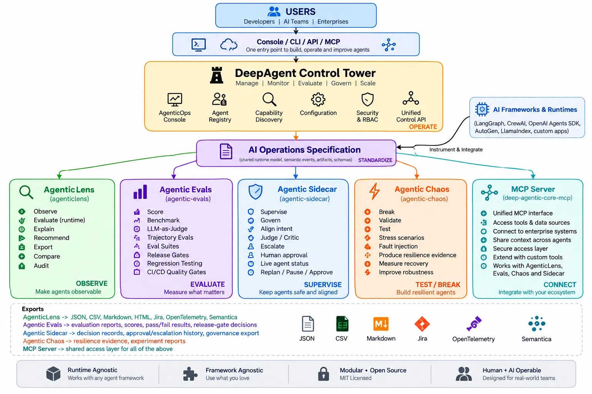

<h1 align="center">DeepAgentLabs</h1>

<strong>Open, modular infrastructure for building, observing, evaluating, and governing AI agents in production.</strong>

  <a href="https://deepagentlabs.io">Website</a> ·
  <a href="https://github.com/DeepAgentLabs/ai-operations-spec">Specification</a> ·
  <a href="https://mcp.deepagentlabs.io">Hosted MCP</a> ·
  <a href="ROADMAP.md">Roadmap</a>

---

## What we're building

DeepAgentLabs is a specification-first ecosystem for operating AI agents: a shared **AI Operations Specification (AIOS)** defines a vendor-neutral contract for what happens when an agent runs, and each project below is a reference implementation of that contract — observing, evaluating, supervising, stress-testing, or exposing it through a common interface.

Every component is independently usable. None of them require each other, and any team can implement the specification without depending on our Python packages.

  

## Projects

| Project | What it does |
| --- | --- |
| [**ai-operations-spec**](https://github.com/DeepAgentLabs/ai-operations-spec) | The AIOS specification: a vendor-neutral contract and shared vocabulary for runs, steps, model/tool calls, retrieval, memory, evaluations, and incidents. |
| [**AgenticLens**](https://github.com/DeepAgentLabs/agenticlens) (`agenticlens`) | Observability, evaluation, and operational intelligence for production AI systems — what ran, why, at what cost, and how to improve it, with failure diagnosis and faulty-step attribution (0.7.0), reviewed, immutable regression suites built from traces and feedback (0.8.0), and evidence-backed model recommendations per task category (0.9.0), and advisory runtime routing from that evidence (0.10.0), and evidence-backed optimization recommendations with post-adoption outcome tracking (0.11.0). |
| [**Agentic Evals**](https://github.com/DeepAgentLabs/agentic-evals) (`agentic-evals`) | A standalone, framework-agnostic scoring engine for LLM and agent outputs, with declarative suite/live evaluation, release gates, and JSON/JUnit/Markdown CI output (0.8.0), plus judge cost, bounded retries, unavailable-judge gating, sampling agreement, and live-target timeouts and async runs (0.9.0), and AIOS evaluation evidence export (0.10.0). |
| [**Agentic Sidecar**](https://github.com/DeepAgentLabs/agentic-sidecar) (`agentic-sidecar`) | A real-time supervision layer that checks an agent's plans and actions against intent, policy, risk, and budget before they execute. |
| [**Agentic Chaos**](https://github.com/DeepAgentLabs/agentic-chaos) (`agentic-chaos`) | A fault-injection toolkit that deliberately breaks agent workflows to measure resilience and recovery, with circuit breakers and dry-run previews (0.5.2), AgenticLens diagnosis span markers (0.5.3), a pytest plugin with fail-closed resilience contracts (0.6.0), cascades, threshold search, synthetic response poisoning and cost estimates (0.7.0), gated multi-stage chaos workflows, linted declarative experiments, explosion-radius scopes and topology fuzzing (0.8.0), and pre/during/post resilience probes with a 0–100 resilience score, bounded score trends and a `--min-score` CI gate (0.9.0). |
| [**MCP Server**](https://github.com/DeepAgentLabs/mcp-server) (`deep-agentic-core-mcp`) | A single MCP interface that exposes workflow inspection, evaluation, and chaos/resilience tooling to AI clients. |
| [**AgenticOps Control Tower**](https://github.com/DeepAgentLabs/agenticops-control-tower) | An operations control plane for inventory, evidence posture, cited MCP investigation and approved verified staging recovery (0.6.0), plus approved fleet desired settings and bounded stop/MCP-revocation coordination (0.7.0), periodic local detection, durable alerts and joined incident console views (0.8.0). |

See the [roadmap](ROADMAP.md) for how these pieces fit together and what's being built next.

**Sidecar v0.8: Shared & Exclusive context/intent and guardrails.** Users may choose
context only, guardrails only, or both, independently Shared across a system/task
or Exclusive to designated agent(s). Each agent receives shared plus assigned
exclusive context; shared guardrails remain mandatory alongside exclusive rules.
v0.8 provides scoped configuration, delivery and composition; v0.9 validates
privacy, authority and lifecycle behavior; v1.0 stabilizes contracts. Explicit host context delivery is implemented; automatic prompt rewriting and
end-to-end private-context isolation are not claimed. Lens 0.7.1 reads correlated
decisions; Semantica export remains conditional.

See the [Sidecar acceptance criteria](https://github.com/DeepAgentLabs/agentic-sidecar/blob/main/ROADMAP.md#shared--exclusive-context-and-guardrails).

## Principles

- **Specification-first** — the contract comes before SDK ergonomics, dashboards, or integrations.
- **Modular** — each project is independently installable and useful on its own.
- **Runtime and framework agnostic** — works alongside LangGraph, CrewAI, the OpenAI Agents SDK, AutoGen, LlamaIndex, and custom agent stacks.
- **Open source** — released under permissive licenses; see each repository for its license.

## Get involved

Found a bug or have an idea? Open an issue or discussion on the relevant repository above. Most projects also publish to PyPI — search for the package name shown next to each project.

## AgenticLens 0.11.0: optimization intelligence

[AgenticLens 0.11.0](https://github.com/DeepAgentLabs/agenticlens/releases/tag/v0.11.0) is released. Roadmap v0.9 turns recorded traces into recommendations you can act on and then check:

- `agenticlens optimize analyze` ranks opportunities across prompts (caching, compression), retrieval (top-k pruning, reranking), memory (summarization, retention), tools (result caching, non-retryable errors), workflows (redundant steps, handoffs that add no work) and models (quality-cost trade-offs between variants). Each cites the runs and spans it came from.
- Projected benefit (with its basis), confidence (with reasons) and quality risks are separate fields and never netted. Cost stays unavailable when any span lacks a recorded cost.
- An append-only ledger tracks accepted, rejected, adopted and reverted recommendations, and `agenticlens optimize outcome` reports projected and observed results side by side after adoption, failing CI when quality regressed.

[MCP 0.4.3](https://github.com/DeepAgentLabs/mcp-server/releases/tag/v0.4.3) adds read-only `lens.optimization_analyze` and pins hosted Lens 0.11.0. Sidecar's locked integration CI moves to Lens 0.11.0. Evals, Chaos, Tower and the spec need documentation only; optimization artifacts are Lens-local. Next for Lens is v1.0, production and enterprise readiness. See the [optimization guide](https://github.com/DeepAgentLabs/agenticlens/blob/v0.11.0/docs/optimization.md).

## Tower 0.6.0: investigation to verified recovery

Phase 6 and Phase 6A ship as one release, paired with MCP 0.3.6. The supported
first runtime is a deterministic staging dependency fixture: detect, investigate
with cited Lens evidence, preview, obtain separate human approval, execute once
and verify fresh Lens/Evals evidence plus a probe. Failed recovery escalates.
Thin Sidecar stop/restart and native MCP revocation adapters preserve runtime
ownership. Production orchestration and hosted tenant credential binding remain
planned. [Walkthrough and scope](https://github.com/DeepAgentLabs/agenticops-control-tower/blob/v0.6.0/docs/incident-recovery.md).

## MCP 0.4.0: unified release checks

[MCP 0.4.0](https://github.com/DeepAgentLabs/mcp-server/releases/tag/v0.4.0) completes Phase 4 with its unified workflows, so a host can ask "is this ready?" across packages in one call:

- **`core.release_check`** gates a Lens baseline/candidate comparison, a native Evals report and a Chaos run report. It **fails closed**: each gate is `passed`, `failed`, `invalid` or `missing`. Malformed or failed-call evidence blocks the release, as does missing evidence of a required kind (all three by default; `required_evidence` narrows that).
- **Evals judges the evaluation** through its own release gate (every `GateConfig` threshold, strict by default, unknown keys rejected). Lens validates the comparison, and Chaos crashes or timeouts block the release while injected faults alone do not.
- **`core.incident_summary`** reports only failure signals, and **`core.export_report`** returns the session's evidence as an MCP-local envelope, not an AIOS artifact.
- **`core.compare_runs`** shares the `lens.compare_runs` path.

All four work on the hosted server; hosted callers pass a locally produced chaos report because remote chaos execution stays disabled. No sibling runtime change, dependency bump or patch release is needed, and Tower's `>=0.3.6,<1` range already admits 0.4.0. MCP's Phase 5 adds hosted access control: tool-level permissions, revocation at dispatch, authenticated stop/revoke and correlated denial evidence. See the [unified workflows guide](https://github.com/DeepAgentLabs/mcp-server/blob/v0.4.0/docs/unified-workflows.md).

## Evals 0.10.0: AIOS evaluation evidence export

[Evals 0.10.0](https://github.com/DeepAgentLabs/agentic-evals/releases/tag/v0.10.0) is released. Evaluation results now travel with the run they judged:

- `to_aios_evidence` turns every score, case verdict and gate decision into an AI Operations Specification `0.4-draft` `evaluation` with criterion, method, result and score, plus an `evaluates` link to the Step or object each case is mapped to. `attach_aios_evidence` merges it into an existing Run, such as a Chaos `to_aios_run` export. `agentic-evals aios export` is the CLI path.
- Nothing is guessed. A missing mapping, an unmapped case or a target missing from the Run fails loudly. Skipped scores are `skipped`, undelivered judgments are `unavailable`, and cases with no observed output are reported rather than exported.
- Merged Runs pass MCP's `spec.validate_artifact` with `conformance.aligned = true`, and Lens's `agenticlens validate` agrees.

Native report schema 1.0 is unchanged. [MCP 0.4.2](https://github.com/DeepAgentLabs/mcp-server/releases/tag/v0.4.2) pins Evals 0.10.0 in its hosted images and tests the export with `spec.validate_artifact`. Tower moves its development pin. Lens, Sidecar, Chaos and the spec need documentation only, and the spec now holds an Evals-produced review artifact. Next is v0.11, adversarial containment scoring, which is still blocked on Sidecar, Chaos, MCP and Lens evidence. See the [AIOS evidence guide](https://github.com/DeepAgentLabs/agentic-evals/blob/v0.10.0/docs/aios-evidence.md).

## Evals 0.9.0: judge reliability, cost and live-target resilience

[Evals 0.9.0](https://github.com/DeepAgentLabs/agentic-evals/releases/tag/v0.9.0) is released. LLM-judged and live evaluations now report what they cost and whether they actually happened:

- **Judge cost and latency** on every judge score, under the `judge_*` keys AgenticLens already reads, totalled in `summary.judge` and kept apart from the agent's own cost.
- **Bounded retries and an explicit unavailable outcome.** A judge that fails after its retries never passes, and the default gate fails and names the affected cases.
- **Repeated judging** (`samples=N`) with per-case agreement, so a flaky judge is detected (`min_judge_agreement`) instead of averaged away.
- **Live-target resilience:** retries with backoff, and per-case `timed_out` / `error` kept apart from wrong answers (`summary.live`, JUnit `<error>`, gate limits).
- **Async** evaluators and targets: `aevaluate_suite` and `arun_live_suite`.

Report schema 1.0 gains optional fields only. [MCP 0.3.14](https://github.com/DeepAgentLabs/mcp-server/releases/tag/v0.3.14) and [Control Tower 0.7.1](https://github.com/DeepAgentLabs/agenticops-control-tower/releases/tag/v0.7.1) bundle the 0.9.0 schemas. Tower also projects judge and live outcomes into evaluation evidence, and MCP's hosted images pin Evals 0.9.0. Lens 0.10.0 passes unchanged on its existing `>=0.7.1,<1` range. Chaos, Sidecar and the spec need documentation only. Next is v0.10, AIOS evaluation evidence export. See the [judge reliability guide](https://github.com/DeepAgentLabs/agentic-evals/blob/v0.9.0/docs/judge-reliability.md).

## Evals 0.8.0: declarative evaluation and release gates

[Evals 0.8.0](https://github.com/DeepAgentLabs/agentic-evals/releases/tag/v0.8.0) is released: `evaluate` handles YAML/JSON
suites and JSON/JSONL samples, `live` calls Python/HTTP targets with concurrency,
`gate` applies release policy, and `pack list/show` discovers built-in packs.
CI can retain native JSON evidence and produce JUnit XML or Markdown summaries.
Evaluation writes evidence even for failures; gate exit codes are 0 pass,
1 failed policy and 2 invalid input/usage. A worked GitHub Actions workflow and
the voice-agent example exercise this path.

Lens approved suite exports remain compatible. MCP and Tower validate native
JSON with their existing 0.7.2 schemas; report schema 1.0 is unchanged. Chaos
and Sidecar remain independent producers, and native reports do not imply AIOS
conformance. No sibling runtime dependency bump or patch release is required.
See the [CLI guide and compatibility matrix](https://github.com/DeepAgentLabs/agentic-evals/blob/v0.8.0/docs/cli.md).

The published native report/gate contract introduced in 0.7.2 remains
supported. v0.9 judge reliability, cost and live-target resilience shipped in
0.9.0; AIOS evaluation evidence export remains planned for v0.10.

## Native Evals contract adoption

MCP 0.3.8 exposes offline `evals.validate_artifact` and validates native reports
in Lens analysis/audit/SLO tools. Tower 0.6.1 validates full Evals reports and
gates before evidence projection; malformed evidence is unavailable. Bundled
upstream 0.7.2 schemas keep both consumers independent of runtime sibling
installations. This is native structural validation, not AIOS conformance.

## AgenticLens 0.9.0: ModelFit

AgenticLens 0.9.0 recommends a model per task category from recorded
experiment reports. Hard constraints on quality, cost, latency, safety,
provider and deployment fail closed, so a limit the evidence cannot verify
rejects the candidate. Each recommendation carries a confidence level with
reasons, an explanation, alternatives, a fallback (on a different provider
when one is feasible),
savings against a reference model tied to the experiment report's SHA-256, and
the quality risks of switching, plus a task-level model matrix. MCP 0.3.11 adds
read-only `lens.modelfit_recommend`; Sidecar 0.8.4 widens its optional Lens
extra to `<1`. ModelFit recommends; runtime routing is Lens v0.8. See the
[guide](https://github.com/DeepAgentLabs/agenticlens/blob/v0.9.0/docs/modelfit.md).

## AgenticLens 0.8.0: test-suite and dataset management

AgenticLens 0.8.0 builds regression suites from CSV/JSON imports, production
traces and user feedback. It masks PII by default before storage, flags duplicates and
conflicting labels, adds synthetic variations and stable splits, and records
reviews. Approved suites become immutable, hash-verified versions that CI
verifies, exports and evaluates. Suites stay plain agentic-evals `TestSuite`
files. MCP 0.3.9 adds read-only `lens.suite_from_traces` and `lens.suite_check`;
Sidecar 0.8.2 widens its optional Lens extra to 0.8. PII detection is pattern
based and approvals are not authenticated. See the
[guide](https://github.com/DeepAgentLabs/agenticlens/blob/v0.8.0/docs/suite-management.md).

## Chaos 0.7.0 interoperability

Chaos 0.7.0 adds sequential fault cascades, deterministic monotonic breaking-point
search, synthetic response poisoning (including prompt/tool-response instruction
and policy-bypass payloads), and explicit-price retry cost estimates. Native
child event IDs and fault types remain intact; cascade IDs/stages and poisoning
strategy/payload/seed are additive event detail. Existing report readers and
AIOS exports remain compatible.

See the [v0.7 guide and offline synthetic example](https://github.com/DeepAgentLabs/agentic-chaos/blob/v0.7.0/docs/v0.7.md).
The example includes observed synthetic dispatches and a bypassed negative
control. Injection or recovery alone does not prove containment. No new shared
schema, automatic adapter, hosted execution capability or containment guarantee
is introduced.

Chaos 0.7.0 ships this milestone; Sidecar 0.8.3 admits its optional dependency and MCP 0.3.10 updates published image pins. Lens, Evals, Tower and AIOS need no runtime releases.

## Control Tower 0.7.0 fleet operations

Tower 0.7.0 adds frozen environment/capability targeting, bulk desired settings,
separate approval, durable per-target results and bounded stop/MCP-revocation
acknowledgement through Python, HTTP and CLI. No fleet atomicity or automatic
rollback/resume is claimed. Timed-out/requested commands need host reconciliation.

Tower owns fleet coordination, Sidecar owns dispatch enforcement, issuers own credential revocation, Lens owns analysis, Evals owns scoring and Chaos owns controlled faults. AIOS remains the shared-semantics authority.

Existing optional dependency ranges remain sufficient. No sibling runtime or
native evidence schema changes are required; this documentation alignment needs
no patch release. See the [operator guide](https://github.com/DeepAgentLabs/agenticops-control-tower/blob/v0.7.0/docs/fleet-operations.md).

See the [local Tower compatibility guide](tower-0.7-fleet-operations.md) for the operator workflow and package boundaries.

## AgenticLens 0.10.0 routing compatibility

AgenticLens 0.10.0 implements roadmap v0.8: evidence-based runtime model
selection, fail-closed routing constraints, bounded provider failover,
confidence/escalation handoffs, shadow/canary modes and a local routing journal.
The default is advisory; execution uses explicit caller-owned callbacks.
MCP 0.3.12 exposes read-only `lens.routing_decide` and pins hosted Lens 0.10.0.
See the [routing guide](https://github.com/DeepAgentLabs/agenticlens/blob/v0.10.0/docs/routing.md)
and [offline example](https://github.com/DeepAgentLabs/agenticlens/blob/v0.10.0/examples/routing_demo.py).

Lens owns model selection and recorded routing outcomes. Sidecar retains
pre-action authority and approvals; Chaos retains fault injection; Evals retains
scoring/gates; Tower retains fleet control and native evidence posture; AIOS
remains the shared contract authority. Routing schemas stay Lens-local.
Only MCP needs a patch release (0.3.12); existing Chaos, Evals and Sidecar ranges
already admit Lens 0.10.0, and Tower/AIOS need no runtime/schema change.

## Chaos 0.8.0 interoperability

Chaos 0.8.0 adds:

- multi-stage chaos workflows: steps, steady-state health checks, parallel
  branches, approval gates that can be resumed, and reusable templates
- declarative YAML/JSON/TOML experiments, with validation that never executes
  targets and cron schedule previews
- `Scope` explosion-radius control (steps, providers and exclusions) on every
  built-in fault and `cascade()`; custom faults get it by calling
  `BaseFault.__init__`, setting `scope` or overriding `in_scope()`
- a topology fuzzer that weights fault placement by fan-out

Native event IDs and fault types are unchanged. Workflow provenance
(`detail.workflow`) and an optional `ChaosReport.workflow` summary are
additive. A workflow's steps merge into one native report for contracts and
AIOS export.

See the [v0.8 guide](https://github.com/DeepAgentLabs/agentic-chaos/blob/v0.8.0/docs/v0.8.md)
and the [offline examples](https://github.com/DeepAgentLabs/agentic-chaos/tree/v0.8.0/examples/workflows).
Workflow statuses, health checks and fuzz outcomes are resilience evidence.
They are not scores, release gates or proof of containment. No new shared
schema, automatic adapter or hosted execution capability is introduced.

Chaos 0.8.0 ships this milestone. Sidecar 0.8.5 admits it as an optional dependency, and MCP 0.3.13 updates the published image pins. Lens, Evals, Tower and AIOS need no runtime releases.

## Sidecar 0.9.0 — authority, privacy and evidence

Sidecar now enforces explicitly bound task authority with narrowed delegation,
ancestor revocation and dispatch-time expiry checks. Scoped context has explicit
reader access and redacted summaries; framework transport and process isolation
remain host responsibilities. Native Decision and sidecar.correlation/1 remain
compatible. Stable shared schemas remain v1.0 work.

The reproducible 24-run synthetic comparison records 0/6 unsafe dispatches with
Sidecar and 2/6 clean false interventions during gate/provider outages. Chaos 0.8
injects faults; Evals 0.9 scores supplied observations; Lens reads native evidence;
Tower keeps governance outcomes separate from deployment health; MCP discovers
installed capability without connecting to a task; AIOS retains schema ownership.

See the [v0.9 guide and migration notes](https://github.com/DeepAgentLabs/agentic-sidecar/blob/v0.9.0/website/docs/v0.9.md).
Only Sidecar needs the 0.9.0 feature release. MCP receives a 0.4.1 compatibility
patch; other siblings retain compatible dependency ranges and need no runtime release.

## AIOS v0.6 canonical examples and extension model

[AI Operations Specification v0.6.0](https://github.com/DeepAgentLabs/ai-operations-spec/tree/v0.6.0/specification/v0.6)
adds exploratory canonical minimal/advanced artifacts, retry examples, schema
and semantic negative controls, and third-party extension guidance. Offline
validation uses the existing v0.4 schemas; artifact markers remain `0.4-draft`.
Independent review is still pending; this repository release does not freeze
any layer or establish stable conformance. Provenance objects and a portable
conformance suite remain v0.6.x work.

Lens and Chaos exports, MCP schema routing, Evals reports, Sidecar decisions and
Tower evidence retain their existing contracts and ownership. No sibling runtime
dependency floor changes or package patch releases are required. See the
[compatibility matrix and offline example workflow](https://github.com/DeepAgentLabs/ai-operations-spec/blob/v0.6.0/docs/v0.6-ecosystem.md).

## Control Tower 0.8.0 live operations

See [operator compatibility and ownership](tower-0.8-live-operations.md) for
periodic detection, durable alerts, acknowledgements and joined incident console
views. Existing native contracts and optional dependency ranges remain compatible;
no runtime or patch release is required here.
