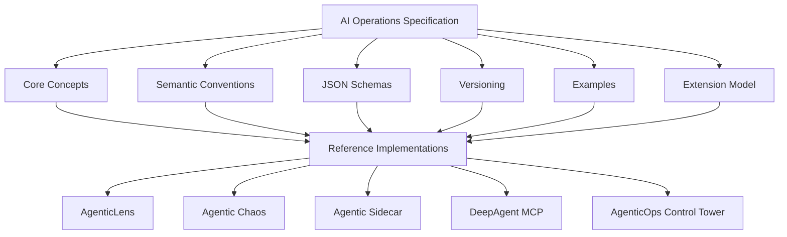
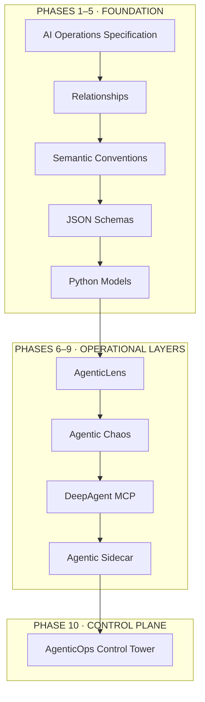
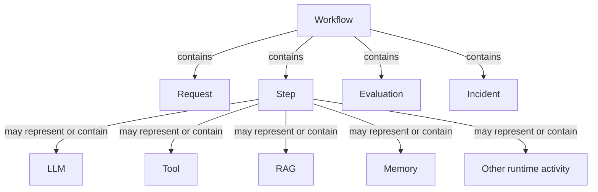
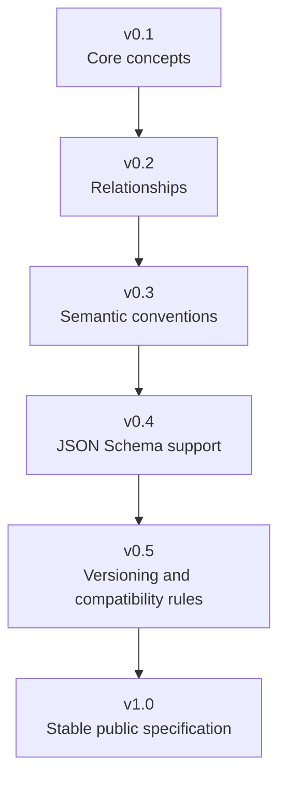
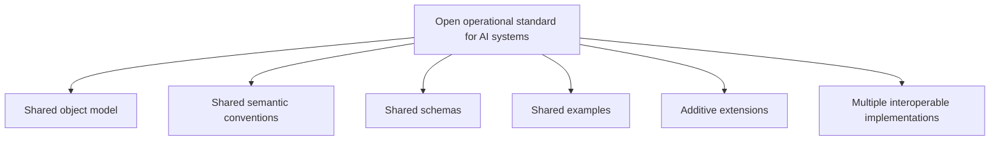

# DeepAgentLabs Roadmap

> DeepAgentLabs should be built **specification-first** toward an **open operational standard for AI systems**.

The AI Operations Specification comes before SDK ergonomics, package features, dashboards, or integrations. The specification is the foundation; the packages are reference implementations of that foundation.

## 🧭 Direction

DeepAgentLabs should follow the pattern used by the strongest ecosystems:

| Ecosystem     | Defined first                            |
| ------------- | ---------------------------------------- |
| OpenTelemetry | Telemetry model and semantic conventions |
| Kubernetes    | API objects                              |
| OpenAPI       | Interface specification                  |

The specification should stay above any one package. Multiple tools should share the same operational contract, and third parties should be able to implement that contract without depending on the Python packages directly.

## 🏗️ Specification-First Architecture



The **AI Operations Specification is the foundation**. It defines the shared concepts, conventions, schemas, versioning, examples, and extension model before package-specific behavior.

The packages are **reference implementations** of that foundation. They should not invent a parallel operational model or independent package types; Python models should represent the specification directly.

This separation keeps the specification above any one package and makes it possible for third parties to implement the contract without taking a dependency on the Python packages.

## 🗺️ Ecosystem Build Journey

This overview groups the numbered phases to make the progression easier to scan; the detailed phase goals follow below.



## 📐 AI Operations Specification

### Initial operational objects

Phase 1 defines the language of AI operations. Questions to answer:

- what is a workflow
- what is a request
- what is a step
- what is an agent
- what is an LLM call
- what is a prompt
- what is a context object
- what is a tool call
- what is a memory operation
- what is a RAG retrieval
- what is an evaluation
- what is a safety signal
- what is a reliability event
- what is an incident

The initial operational objects are:

| Runtime objects                           | Runtime activity and outcomes         |
| ----------------------------------------- | ------------------------------------- |
| `Workflow` · `Request` · `Step` · `Agent` | `LLM` · `Prompt` · `Context` · `Tool` |
| `Memory` · `RAG` · `Evaluation`           | `Safety` · `Reliability` · `Incident` |

At this stage, the focus is on **definitions, relationships, and terminology**, not Python APIs or exporters.

### Explicitly defined relationships

The diagram below shows only relationships stated in Phase 2. A `Step` may represent or contain the listed runtime activity or other runtime activity.



### Phase 3 semantic conventions

Canonical AI-native event names and meanings give the ecosystem consistent language for AI runtimes. The roadmap's examples are grouped by subject here for scanning; no additional event names are implied.

| Subject    | Event names                               |
| ---------- | ----------------------------------------- |
| Workflow   | `workflow.started` · `workflow.completed` |
| Request    | `request.started` · `request.completed`   |
| Agent      | `agent.started` · `agent.step`            |
| LLM        | `llm.call`                                |
| Prompt     | `prompt.rendered`                         |
| Context    | `context.injected`                        |
| Tool       | `tool.called`                             |
| Memory     | `memory.read` · `memory.write`            |
| RAG        | `rag.retrieved`                           |
| Evaluation | `evaluation.run` · `judge.scored`         |
| Incident   | `incident.created`                        |

This is where the ecosystem starts to feel analogous to OpenTelemetry semantic conventions, but for AI runtimes.

## 🔭 10-Phase Roadmap

```text
01 ── AI Operations Specification
 │
02 ── Relationships and Execution Structure
 │
03 ── Semantic Conventions
 │
04 ── JSON Schemas
 │
05 ── Python Models
 │
06 ── AgenticLens
 │
07 ── Agentic Chaos
 │
08 ── DeepAgent MCP
 │
09 ── Agentic Sidecar
 │
10 ── AgenticOps Control Tower
```

### Phase 1 — AI Operations Specification

**Goal:** Define the language of AI operations before implementing package-specific behavior.

**Questions:** What is a workflow, request, step, agent, LLM call, prompt, context object, tool call, memory operation, RAG retrieval, evaluation, safety signal, reliability event, or incident?

**Initial operational objects:** `Workflow`, `Request`, `Step`, `Agent`, `LLM`, `Prompt`, `Context`, `Tool`, `Memory`, `RAG`, `Evaluation`, `Safety`, `Reliability`, `Incident`.

**Focus:** Definitions → relationships → terminology. Not Python APIs or exporters.

### Phase 2 — Relationships and Execution Structure

**Goal:** Define how the runtime objects connect.

- `Workflow` contains `Request`, `Step`, `Evaluation`, and `Incident`.
- `Step` may represent or contain `LLM`, `Tool`, `RAG`, `Memory`, or other runtime activity.
- Workflows may have parent-child relationships.
- Execution may be sequential, parallel, or graph-shaped.
- Agent handoffs and delegation should have a portable representation.

Define the execution graph model clearly enough that multiple tools can represent the same run consistently.

### Phase 3 — Semantic Conventions

**Goal:** Define canonical AI-native event names and meanings.

See the grouped event table above for every example in the roadmap. This is the point where the ecosystem starts to feel analogous to OpenTelemetry semantic conventions, but for AI runtimes.

### Phase 4 — JSON Schemas

**Goal:** Make artifacts validatable and portable.

Examples: `workflow.schema.json`, `agent.schema.json`, `evaluation.schema.json`, and future object-specific schemas. The output is a schema-backed artifact model that tools can produce and consume consistently.

### Phase 5 — Python Models

**Goal:** Represent the specification directly in Python.

Examples: `Workflow`, `Step`, `Agent`, `Prompt`, `ToolCall`, and `Evaluation`. These should be implementation models of the specification, not ad hoc package types invented independently in each repo.

### Phase 6 — AgenticLens

**Goal:** Make the specification observable in Python applications.

AgenticLens should populate the AI Operations Specification from real runtime activity, then export it as:

- `workflow.json`
- JSON, CSV, and Markdown
- OpenTelemetry traces, logs, and metrics
- OTLP and future transports

AgenticLens should answer:

- What ran?
- Why did it behave that way?
- What did it cost?
- Did it perform well?

### Phase 7 — Agentic Chaos

**Goal:** Extend the same operational model with resilience and failure evidence.

Agentic Chaos should not invent a parallel model. It should extend the same workflow artifact with chaos and degradation evidence.

Agentic Chaos should answer:

- What breaks under stress?
- How badly does it break?
- Did recovery work?

### Phase 8 — DeepAgent MCP

**Goal:** Expose the same artifact and model through one MCP-native interface.

The MCP server should read and operate on the shared operational contract:

```text
workflow.json
    ↓
analyze()
recommend()
compare()
report()
```

This keeps the MCP layer thin, portable, and aligned with the rest of the ecosystem.

### Phase 9 — Agentic Sidecar

Sidecar **0.8.0** builds on implemented 0.7 live status,
immutable audit records and local Control Room controls. v0.8 adds native
LangGraph/AutoGen/CrewAI/OpenAI Agents/Google ADK tool boundaries, real MCP
transport/gateway validation and versioned native decision correlation.
Lens 0.7.1 reads correlated decisions and verifies native journal chains;
Chaos 0.5.3 recovery proposals retain fault IDs. Tower 0.5.2 keeps governance
outcomes separate from deployment health; MCP server 0.3.5 retains discovery
and transport ownership. Live-provider smoke remains pending credentials.

Shared & Exclusive context/intent and guardrails are implemented at the v0.8
configuration/delivery/composition level: context only, guardrails only, or both,
scoped across a system/task or designated agents. Shared restrictions cannot be
weakened by agent-specific rules. Context transport is explicit and host-owned;
in-process wrappers are not isolation. v0.9 validates privacy, authority and
lifecycle behavior; v1.0 stabilizes schemas. Semantica export remains conditional
on upstream API validation. AIOS records the native correlation convention as a
non-normative draft, not stable conformance.
See the [canonical roadmap](https://github.com/DeepAgentLabs/agentic-sidecar/blob/main/ROADMAP.md).

**Goal:** Add pre-action supervision and decision governance against the same operational model.

Agentic Sidecar should answer:

- Is the next action aligned with user intent?
- Is the action policy-compliant?
- Does the action require escalation, replanning, or blocking?

### Phase 10 — AgenticOps Control Tower

v0.1–v0.5 are released: optional SQLite registry persistence, reader/writer
authorization, HTTP and offline CLI inventory, shared health and capability
coverage summaries, agent filters, the read-only console, controlled desired
configuration with independent approval and audit, and pushed Lens, Evals,
Sidecar and Chaos evidence shown as fresh/stale/missing posture.

**Goal:** Build an AI-native operations command center and unified control plane
for autonomous agents: live evidence, investigation through MCP and an operations
copilot, human approvals, automated runbooks and verified recovery.

The first approved incident-to-recovery staging scenario ships with the local MCP
investigation connector in Tower 0.6.0 (Phase 6 and 6A combined). The supported
runtime is a deterministic dependency fixture. Tower 0.8.0 adds periodic local
detection, durable alerts and incident console views; reusable production runbooks
remain v0.9 work. Tower coordinates them while Lens,
Evals, Sidecar and Chaos retain their engines.

AgenticOps Control Tower should not replace Lens, Chaos, Sidecar, or MCP. It should centralize:

- Agent inventory
- Capability discovery
- Health and status rollups
- Centralized configuration
- Multi-agent operational workflows

It should answer:

- What is deployed?
- Where is it running?
- Which capabilities and versions are present?
- What is unhealthy?
- What should operators manage from one place?

## 📦 Package Roles

| Package                    | Role                                            |
| -------------------------- | ----------------------------------------------- |
| `ai-operations-spec`       | Defines the standard.                           |
| `agenticlens`              | Observes and evaluates the standard.            |
| `agentic-chaos`            | Tests and stress-validates the standard.        |
| `agentic-sidecar`          | Governs decisions against the standard.         |
| `deep-agentic-core-mcp`    | Connects the standard through MCP.              |
| `agenticops-control-tower` | Operates the ecosystem through a control plane. |

The ecosystem should stay cleanly separated:

- `ai-operations-spec` defines the standard.
- `agenticlens` instruments and exports the standard.
- `agentic-chaos` extends the standard with resilience evidence.
- `deep-agentic-core-mcp` exposes the standard through MCP.

The specification stays above any one package, making ecosystem adoption easier for third parties that want to implement the contract without depending on the Python packages directly.

## 📋 Specification Milestones

The AI Operations Specification itself should evolve in these milestones. The sequence below describes milestone scope; it does not imply completion status.



<details>
<summary>Milestone scope</summary>

| Milestone | Exact scope                                                                                                                                                    |
| --------- | -------------------------------------------------------------------------------------------------------------------------------------------------------------- |
| **v0.1**  | Core concepts: `Workflow`, `Request`, `Step`, `Agent`, `LLM`, `Prompt`, `Tool`, `Context`, `RAG`, `Memory`, `Evaluation`, `Safety`, `Reliability`, `Incident`. |
| **v0.2**  | Relationships: workflow-to-step structure, parent-child relationships, execution graph representation.                                                         |
| **v0.3**  | Semantic conventions: `workflow.started`, `llm.call`, `tool.call`, related canonical event names and lifecycle meanings.                                       |
| **v0.4**  | JSON Schema support.                                                                                                                                           |
| **v0.5**  | Versioning and compatibility rules.                                                                                                                            |
| **v1.0**  | Stable public specification.                                                                                                                                   |

</details>

## 🚧 Current Implementation Priorities

The following items are the current implementation priorities, grouped by the roadmap's urgency labels. Items remain in their source categories.

### 🔴 Implement Now

**`deep-agentic-core-mcp`** — _(sessions, rich diagnostics, tool annotations,
prompt registry, and `core.verify` in `0.2.0`; optional authenticated HTTP,
DynamoDB signup/key lifecycle, Redis user-scoped state, and Sidecar discovery
in `0.3.0`; Phase 3 completed in `0.3.3`)_

Local stdio remains supported. Hosted access is available at
`https://mcp.deepagentlabs.io/mcp`, with signup at `https://mcp.deepagentlabs.io`.
Version-tag releases publish to PyPI before deploying the same source to AWS;
ordinary main-branch pushes run checks without deploying.

- ~~Provenance verification on `lens.analyze_workflow`'s response shape~~ ✅ `0.3.3`.
- ~~Multi-version AIOS schema support + conformance-style reporting~~ ✅ `0.3.3` (`spec_version` routing and rule-cited reports over the `ai-operations-spec` `0.5.1` catalogs).
- ~~Unified workflows: joined observability + chaos, incident/readiness reporting~~ ✅ `0.4.0` (fail-closed `core.release_check`, `core.incident_summary`, `core.export_report`). MCP's Phase 5 adds hosted access control: tool-level permissions, revocation at dispatch, authenticated stop/revoke and correlated denial evidence.

**`agenticlens`** — _(evidence/provenance objects, next-best-analysis guidance, OpenTelemetry export, import-layer enforcement, and AIOS conformance CLI shipped in `0.4.0`; v0.3 evaluation evidence and v0.4 experiments and statistical comparison shipped in `0.6.0`; step provenance on every default recommendation in `0.6.1`; v0.5 advanced evaluation and diagnosis shipped in `0.7.0`; v0.6 test-suite and dataset management shipped in `0.8.0`; v0.7 ModelFit shipped in `0.9.0`; v0.8 advisory runtime routing shipped in `0.10.0`; v0.9 optimization intelligence shipped in `0.11.0`)_

- Built-in provider clients for LLM-judge calls.
- ~~v0.5 advanced evaluation and diagnosis: failure taxonomy, faulty-step attribution, judge cost recording~~ ✅ `0.7.0`. ~~v0.6 test-suite and dataset management~~ ✅ `0.8.0`. ~~v0.7 ModelFit~~ ✅ `0.9.0`. ~~v0.8 advisory runtime routing~~ ✅ `0.10.0`. ~~v0.9 optimization intelligence~~ ✅ `0.11.0`. Next: v1.0 production and enterprise readiness.
- ~~Judge calibration reports and statistical confidence intervals~~ ✅ `0.5.0` (agreement intervals); threshold tuning ✅ `0.6.0`.
- ~~Versioned evaluation datasets (summary, split, sample export)~~ ✅ (`agenticlens dataset`); ~~dataset lifecycle management (immutable snapshots, approvals)~~ ✅ `0.8.0` (`agenticlens suite`).
- ~~Experiment/variant manifests and statistical comparison~~ ✅ `0.6.0` (pass@k/pass^k, intervals, significance tests, heatmaps, HTML/CSV).

**`agentic-chaos`**

- ~~v0.6 pytest plugin and assertions~~ ✅ `0.6.0` (`pytest --chaos`, seven contracts, CLI contract gating).
- Structured experiment traces/reports (hypothesis, injection point, fault, observed behavior, recovery outcome, verdict, provenance).
- Synthetic test scenarios (prebuilt known-bad agent behaviors).
- v0.7 fault cascades, adaptive intensity and response poisoning.

**`ai-operations-spec`**

- Provenance/evidence concepts in the spec.
- Conformance test suite for producers.
- Naming conventions document.

**Cross-cutting (done)**

- `AGENTS.md` in each repo ✅
- `CI.md` pre-push quality guide in each repo ✅

### 🟡 Implement Next

**`agenticlens`**

- ~~Investigation-style narratives on recommendations~~ ✅ `0.7.0` (`agenticlens explain`).
- ~~Remaining CLI subcommands (`trace show`, `report explain`)~~ ✅ `0.7.0` (`trace show`, `trace timeline`, `explain`, `diagnose`).
- ~~v0.6 test-suite and dataset management: trace-to-test-case conversion, immutable approved suites, PII masking~~ ✅ `0.8.0`.
- ~~v0.7 ModelFit: task-level model recommendations under hard constraints, tied to experiment evidence~~ ✅ `0.9.0`.
- ~~v0.8 advisory runtime routing: rule- and score-based routing from ModelFit evidence, fallback chains, shadow and canary modes, routing audit log~~ ✅ `0.10.0`.
- ~~v0.9 optimization intelligence: evidence-backed recommendations, accepted/rejected tracking and adoption outcome evaluation~~ ✅ `0.11.0`.
- ~~Analysis guardrails (budget limits, stagnation detection)~~ ✅ `0.7.0` (`AnalysisBudget`, `AnalysisGuard`).
- ~~Structured judge verdict fields (agree/partially-agree/disagree, confidence score, factual-grounding breakdown)~~ ✅ `0.6.0`.

**`agentic-chaos`**

- Resilience benchmark fixtures/datasets.
- Parallel/sharded test execution.

**`ai-operations-spec`**

- Migration guides between spec versions.
- Hosted docs site.
- Report/investigation artifact schemas.

**`deep-agentic-core-mcp`**

- Guided onboarding wizard.
- Saved artifact browsing through MCP resources.
- Explainable report recall and session history.

### ⚪ Defer

- `agenticlens` full interactive REPL/shell.
- `agentic-chaos` local chaos-lab stack (Docker Compose/kind).
- `deep-agentic-core-mcp` fleet/process registry.
- `deep-agentic-core-mcp` full gateway/multi-surface architecture.
- Conversational long-term memory in `agenticlens` or `agentic-chaos`.

## 🧩 Recommended Build Order

This is the roadmap's recommended order; shipped annotations and the named frontier are retained as stated.

| Order | Work                                                                                                             | Roadmap status                            |
| ----: | ---------------------------------------------------------------------------------------------------------------- | ----------------------------------------- |
|     1 | `deep-agentic-core-mcp` — sessions, diagnostics, tool metadata, prompts, verification                            | ~~✅ shipped in `0.2.0`~~                 |
|     2 | `agenticlens` — provenance/evidence, next-step recommendations, OTel, layer enforcement, conformance CLI         | ~~✅ shipped in `0.4.0`~~                 |
|     3 | `agentic-chaos` — structured reports/traces, synthetic scenarios                                                 | **current frontier**                      |
|     4 | `ai-operations-spec` — provenance/evidence/report semantics, naming rules, conformance requirements and fixtures | No status stated in this build-order list |

### Current frontier

> **Agentic Chaos** — structured experiment traces/reports (hypothesis, injection point, fault, observed behavior, recovery outcome, verdict, provenance) and synthetic test scenarios (prebuilt known-bad agent behaviors).

## 🌐 North Star

The long-term goal is not just a Python toolkit. It is an **open operational standard for AI systems** with a shared object model, shared semantic conventions, shared schemas, shared examples, additive extensions, and multiple interoperable implementations.



### Control Tower evidence alignment

Control Tower owns fleet operations; Lens owns observability; Evals owns scoring
and release gates; Sidecar supervises decisions; Chaos runs resilience
experiments; AIOS defines draft shared semantics. Tower provides local native
artifact readers and explicit deployment/evidence attribution. Since v0.5 it
stores pushed evidence and shows posture in the API, CLI and console. Pull
collection from producer services remains planned; fleet health remains
separate from producer outcomes. No stable AIOS conformance is claimed.

## Operational safety guarantees (planned)

Added 2026-10-11. Local blocking/stopping, hosted MCP key revocation, tracing,
fault injection and evaluation checks exist in parts. The following integrated
guarantees remain planned; package roadmaps contain their acceptance criteria.

| Guarantee | Implementation owner and dependencies |
| --- | --- |
| Emergency brake | Sidecar owns stop, dispatch blocking and task-access revocation; MCP/credential issuers execute revocation; Tower coordinates operators |
| Independent policy enforcement | Sidecar owns independent policy enforcement; MCP enforces its access boundary; protected tools reachable only through an enforcing boundary |
| Verifiable execution evidence | Lens AIOS-format capture, offline evidence replay and integrity verification; Sidecar/MCP policy/action correlation; Tower presentation |
| Adversarial containment validation | Chaos attacks/failures; Evals containment scoring/gates; Sidecar/MCP enforcing targets |

Shared command, authority and evidence semantics must be coordinated in AI
Operations Specification before claiming interoperable contracts. Stop must block
further dispatch independently of the LLM; in-flight effects and unsupported
credential revocation must remain visible. Evidence must distinguish verdicts
from actual execution and verification from ordinary schema validation.
Containment requires reproducible zero-violation tests and negative controls,
not only successful recovery or safe-sounding answers.

See the [Sidecar](https://github.com/DeepAgentLabs/agentic-sidecar/blob/main/ROADMAP.md),
[MCP](https://github.com/DeepAgentLabs/mcp-server/blob/main/ROADMAP.md),
[Tower](https://github.com/DeepAgentLabs/agenticops-control-tower/blob/main/ROADMAP.md),
[Lens](https://github.com/DeepAgentLabs/agenticlens/blob/main/agenticlens-roadmap.md),
[Chaos](https://github.com/DeepAgentLabs/agentic-chaos/blob/main/ROADMAP.md) and
[Evals](https://github.com/DeepAgentLabs/agentic-evals/blob/main/ROADMAP.md) roadmaps.


## Tower v0.4 controlled configuration

[Control Tower v0.4.0](https://github.com/DeepAgentLabs/agenticops-control-tower/releases/tag/v0.4.0)
adds Tower-owned desired configuration, bounded action previews, independent
approval/denial, expiry, revocation, revision checks and atomic one-use execution.
HTTP/CLI expose the same durable configuration and audit model. Runtime-owned
settings remain mirrored or unsupported; desired-state changes do not claim a
remote runtime update. The console remains read-only. Lens 0.5, Evals 0.7,
Sidecar 0.7, Chaos 0.4 and MCP 0.3.1 remain optional integrations; no writable
sibling adapter or task stop/revoke transport is shipped.

## Agentic Chaos v0.5

[Agentic Chaos v0.5.0](https://github.com/DeepAgentLabs/agentic-chaos/releases/tag/v0.5.0)
adds sync/async streaming cuts, bounded hangs and delivery delays, reversible
patches for explicit OpenAI/Anthropic/Google Gen AI client instances, seeded fault
probability, TOML profiles, and authentication/context-length simulations.
Provider SDKs and ecosystem packages remain optional. Native report fields are
unchanged: Lens consumes the events, MCP discovers new fault names dynamically,
and Tower reads native chaos evidence separately from fleet health.

The [v0.5 guide](https://github.com/DeepAgentLabs/agentic-chaos/blob/main/docs/v0.5.md)
documents API coverage and compatibility tests. Structured experiment reports
remain unfinished v0.2.x work (the AIOS run export shipped in `0.5.1`, below).
Safety rails subsequently ship in `0.5.2` (see below); `0.5.0` itself does not
claim those capabilities.

## MCP 0.3.2 and Chaos 0.5 compatibility

[MCP v0.3.2](https://github.com/DeepAgentLabs/mcp-server/releases/tag/v0.3.2)
adds real integration tests and an offline streaming experiment target for
Chaos v0.5's dynamic fault catalog and native experiment events. Local stdio
runs trusted workspace scripts; hosted HTTP rejects chaos execution. The
release keeps Chaos optional and does not expose profile/provider configuration
through a new MCP request schema. See the
[MCP user guide](https://github.com/DeepAgentLabs/mcp-server/blob/main/docs/user-guide.md#chaos-v05-streaming-with-mcp-032).

## Phase 3 completion: MCP 0.3.3 with Lens 0.6.1, Chaos 0.5.1 and AIOS 0.5.1

[MCP v0.3.3](https://github.com/DeepAgentLabs/mcp-server/releases/tag/v0.3.3)
completes MCP Phase 3. Three patch releases supply what it composes:

- [AgenticLens 0.6.1](https://github.com/DeepAgentLabs/agenticlens/releases/tag/v0.6.1):
  every default recommendation, including model swaps and chaos impact, names
  its step and cites evidence for it. In MCP, `lens.analyze_workflow` adds a
  provenance block (artifact digest, step, spans) to each finding, with an
  explicit `resolved` status that is false whenever the step or a span is absent
  from the caller's artifact.
- [Agentic Chaos 0.5.1](https://github.com/DeepAgentLabs/agentic-chaos/releases/tag/v0.5.1):
  `to_aios_run()` and `--save-aios` export a chaos report as an AIOS
  v0.4-draft Run. In MCP, `chaos.run_experiment` attaches that export and
  reports its validation result separately (`aios_export.aligned`),
  `chaos.export_aios_run` converts saved reports, and a script allow/deny glob
  policy narrows which local scripts can run.
- [AI Operations Specification 0.5.1](https://github.com/DeepAgentLabs/ai-operations-spec/releases/tag/v0.5.1):
  machine-readable conformance rule IDs and the v0.5 compatibility catalog. In
  MCP, `spec.validate_artifact` routes by `spec_version` and reports which
  `AIOS-0.4-*` and `AIOS-0.5-*` rules pass or fail, separately from server
  presentation.

Each sibling remains optional for MCP. An older sibling degrades rather than
failing. With an older Lens, findings without a step report `resolved: false`.
With Chaos 0.5.0, the export reports `available: false`. With an older spec
checkout, the conformance report has no rule catalog. These are
draft-alignment claims, not stable AIOS conformance; Lens integrity
verification remains planned. Tower 0.6.0 now supplies thin Sidecar stop and
native MCP issuer revocation adapters with explicit containment limits.

## Tower v0.5 ecosystem evidence posture

[Control Tower v0.5.0](https://github.com/DeepAgentLabs/agenticops-control-tower/releases/tag/v0.5.0)
completes its ecosystem surface phase. Producers or pipelines push native Lens
runs, Evals reports and gates, Sidecar decisions and Chaos reports with explicit
deployment attribution. Tower stores the validated projection idempotently and
reports, per deployment and producer, whether evidence is fresh, stale or
missing, with counts of native outcomes, through Python, HTTP, CLI, offline
snapshots and the read-only console.

Lens runs now expose trace, timing, tool and failed-span correlation for later
incident investigation. Tower never recomputes an evaluation, decision or
resilience verdict, and producer outcomes never change reported health. Optional
floors are Lens 0.6, Evals 0.7, Sidecar 0.7, Chaos 0.5 and MCP 0.3.4; none is
required. The Lens, Evals, Sidecar and Chaos readers are checked against their
published packages; MCP is a declared floor only. Pull collection,
AIOS mapping and journal integrity verification remain planned. The MCP
connector and investigation prompt now ship with approved staging recovery
in Tower 0.6.0; see the combined milestone below.

## AgenticLens 0.9.0: ModelFit

[AgenticLens 0.9.0](https://github.com/DeepAgentLabs/agenticlens/releases/tag/v0.9.0)
delivers Lens roadmap milestone v0.7. `agenticlens modelfit recommend` reads
recorded experiment reports and recommends a model per task category; a
category selects cases by tag, domain or case ID. Candidates that break a hard
constraint (pass rate and its interval, cost per case and per success, mean
and p95 latency, consistency, suite-wide safety pass rate, provider,
deployment, capabilities), or whose evidence cannot show they meet it, are
never recommended. Feasible candidates are scored with configurable weights,
and each category reports its Pareto frontier and cost-per-success ranking.
Recommendations carry confidence with reasons, explanations citing measured
values, alternatives, a fallback (provider-diverse when one is feasible),
savings against a reference
variant on the same cases (citing the experiment report's SHA-256), and quality
risks; `--fail-on-unfit` gates CI when a category has no feasible model.

Sibling releases in the same window:

- [MCP 0.3.11](https://github.com/DeepAgentLabs/mcp-server/releases/tag/v0.3.11):
  read-only `lens.modelfit_recommend`; hosted images pin Lens 0.9.0.
- [Agentic Sidecar 0.8.4](https://github.com/DeepAgentLabs/agentic-sidecar/releases/tag/v0.8.4):
  the optional `agenticlens` extra admits 0.9 (`<1`).

Chaos, Evals, Control Tower and the spec need no release: ModelFit reads Lens
experiment reports only, computes no release gate, reports no fleet health,
and its schemas are Lens-local, not AIOS objects.

## AgenticLens 0.8.0: test-suite and dataset management

[AgenticLens 0.8.0](https://github.com/DeepAgentLabs/agenticlens/releases/tag/v0.8.0)
delivers Lens roadmap milestone v0.6. `agenticlens suite` imports cases from
CSV and JSON and converts successful production traces and user feedback into
cases that need review. Failed runs and uncorrected negative feedback are
skipped with a reason. Suites can be edited, tagged by domain, split stably
(variants follow their original), extended with deterministic surface
variations, de-duplicated (conflicting labels flagged) and PII-masked by
default before storage. Approval refuses unreviewed or rejected cases, unmasked PII and
conflicting duplicates. It then writes an immutable version whose suite and
approval record are re-hashed on every read, so CI can verify, export,
evaluate and gate exactly what was reviewed.

Sibling releases in the same window:

- [MCP 0.3.9](https://github.com/DeepAgentLabs/mcp-server/releases/tag/v0.3.9):
  read-only `lens.suite_from_traces` and `lens.suite_check`; hosted images pin
  Lens 0.8.0.
- [Agentic Sidecar 0.8.2](https://github.com/DeepAgentLabs/agentic-sidecar/releases/tag/v0.8.2):
  the optional `agenticlens` extra admits 0.8.

Chaos, Evals, Control Tower and the spec need no release: suites remain
agentic-evals `TestSuite`s and the suite schemas are Lens-local, not AIOS
objects.

## AgenticLens 0.7.0: advanced evaluation and diagnosis

[AgenticLens 0.7.0](https://github.com/DeepAgentLabs/agenticlens/releases/tag/v0.7.0)
delivers Lens roadmap milestone v0.5. `agenticlens diagnose` explains a failed
run from its trace. It applies a versioned failure taxonomy and deterministic
rules whose diagnoses carry confidence and supporting spans. It attributes the
failure to a step and an agent (discounting recovered failures and downstream
consequences), rebuilds the incident timeline, flags anomalies against healthy
baseline runs, and writes an investigation narrative. Attribution accuracy is
measured on controlled failures. On the bundled 40-case synthetic corpus,
attribution finds the faulty step 40/40 times; that corpus is not independent
evidence. Evaluation gains trace-aware evaluators (trajectory, handoff, loop,
retrieval groundedness and citations, safety in tool arguments), judge cost
and prompt-version recording, and reports that keep deterministic and
model-based scores apart and show where evaluators disagree. AIOS conformance
now cites rule IDs from the spec's catalog.

Sibling releases in the same window:

- [Agentic Chaos 0.5.3](https://github.com/DeepAgentLabs/agentic-chaos/releases/tag/v0.5.3):
  `mark_span()` tags a Lens trace span with the injected fault, so chaos runs
  become ground truth for Lens attribution accuracy.
- [MCP 0.3.5](https://github.com/DeepAgentLabs/mcp-server/releases/tag/v0.3.5):
  `lens.diagnose_run` and `lens.score_analysis`; hosted images pin Lens 0.7.0.
- [Control Tower 0.5.1](https://github.com/DeepAgentLabs/agenticops-control-tower/releases/tag/v0.5.1):
  reads Lens diagnosis reports as native evidence and tallies attribution
  outcomes and faulty agents in posture, without re-diagnosing.

## Agentic Chaos 0.5.2 safety rails

The v0.5.x safety milestone ships in
[Agentic Chaos 0.5.2](https://github.com/DeepAgentLabs/agentic-chaos/releases/tag/v0.5.2).
Circuit breakers bound explicitly recorded cost, rolling exception rate,
cooperative duration, and admitted injection count. Dry-run records selected
faults while target calls and streams execute normally. Abort prevents later
instrumented dispatches and reports already-running work separately; direct
uninstrumented calls remain outside that boundary.

The [safety guide](https://github.com/DeepAgentLabs/agentic-chaos/blob/main/docs/safety.md)
defines accounting and containment limits. Native safety fields are additive;
AIOS exports retain them in the producer extension and mark aborted runs
`cancelled`, without treating previews as observed failure evidence. Current
Lens, Tower, MCP saved-report export, and AIOS readers are compatibility-tested;
no sibling patch release is required. MCP's run tool does not yet expose the new
safety execution flags. Pytest integration/assertions (v0.6) are next, alongside
the remaining structured ExperimentReport and synthetic-scenario backlog.

## Tower 0.6.0 combined Phase 6/6A release

Tower 0.6.0 and MCP 0.3.6 deliver local authenticated investigation tools and
cited evidence assembly, exact-preview human approval, durable at-most-one
execution claims, and verified staging recovery with failure escalation.
The native-producer walkthrough uses Lens 0.7.1 and Evals 0.7.1. Sidecar 0.8.0
retains dispatch stop/restart and revoker enforcement; Chaos 0.5.3 retains fault
injection and native reports. `ai-operations-spec` catalog release 0.5.1 retains AIOS v0.4-draft schemas;
Tower-local incident and approval contracts do not become normative schemas. Producer dependencies stay
optional and unchanged. Documentation-only alignment needs no sibling releases.

Supported scope: deterministic local SQLite staging dependency fixture, explicit
detection, independent approval, fresh same-run Lens/Evals plus probe checks,
manual reconciliation of interrupted/partial execution, and thin emergency
braking adapters. Hosted MCP Tower credentials and production runtime remediation
remain planned. Fleet operations ship in Tower 0.7.0; broader incident console views remain later work.

[Operator walkthrough](https://github.com/DeepAgentLabs/agenticops-control-tower/blob/v0.6.0/docs/incident-recovery.md) ·
[MCP setup](https://github.com/DeepAgentLabs/agenticops-control-tower/blob/v0.6.0/docs/mcp-connector.md).

## Agentic Chaos 0.6.0 pytest plugin and contracts

[Agentic Chaos 0.6.0](https://github.com/DeepAgentLabs/agentic-chaos/releases/tag/v0.6.0)
makes chaos part of an ordinary test run. A `@pytest.mark.chaos` test runs under
faults when pytest is started with `--chaos`; without the flag it runs normally.
Seven contracts check the run's native report and return `passed`, `failed`
or `inconclusive`:
`CompletesWithin`, `NoUnhandledError`, `MaxRetries`, `RecoveredAfterFailure`,
`MaxCostImpact`, `NoRetryStorm` (retries across the whole topology) and
`FullTopologyTraversal` (every baseline node still ran). Contracts fail closed:
a check the report cannot support, including one on a report written before 0.6,
is `inconclusive`, and inconclusive never passes. The same contracts gate
`agentic-chaos chaos run --contract ...` and `contracts check` on saved reports.

Reports gain an additive call log and the escaped `unhandled_error`. Lens and
Tower readers ignore them, and the AIOS export carries only call counts and the
error in the producer extension, so no core AIOS object changes. Contract
verdicts are Chaos-native per-run checks; Evals still owns scoring and release
gates. The [v0.6 guide](https://github.com/DeepAgentLabs/agentic-chaos/blob/main/docs/v0.6.md)
covers the marker, the fixture, async tests and the exact retry and visit definitions.

Sibling releases in the same window:

- [Agentic Sidecar 0.8.1](https://github.com/DeepAgentLabs/agentic-sidecar/releases/tag/v0.8.1):
  the optional `agentic-chaos` extra admits 0.6; no runtime change.
- [MCP 0.3.7](https://github.com/DeepAgentLabs/mcp-server/releases/tag/v0.3.7):
  hosted images pin Chaos 0.6.0; MCP tools are unchanged.

Lens, Evals, Tower and AIOS spec changes are documentation-only.


## MCP 0.4.0: unified release checks

[MCP 0.4.0](https://github.com/DeepAgentLabs/mcp-server/releases/tag/v0.4.0) completes Phase 4 with its unified workflows, so a host can ask "is this ready?" across packages in one call:

- **`core.release_check`** gates a Lens baseline/candidate comparison, a native Evals report and a Chaos run report. It **fails closed**: each gate is `passed`, `failed`, `invalid` or `missing`. Malformed or failed-call evidence blocks the release, as does missing evidence of a required kind (all three by default; `required_evidence` narrows that).
- **Evals judges the evaluation** through its own release gate (every `GateConfig` threshold, strict by default, unknown keys rejected). Lens validates the comparison, and Chaos crashes or timeouts block the release while injected faults alone do not.
- **`core.incident_summary`** reports only failure signals, and **`core.export_report`** returns the session's evidence as an MCP-local envelope, not an AIOS artifact.
- **`core.compare_runs`** shares the `lens.compare_runs` path.

All four work on the hosted server; hosted callers pass a locally produced chaos report because remote chaos execution stays disabled. No sibling runtime change, dependency bump or patch release is needed, and Tower's `>=0.3.6,<1` range already admits 0.4.0. MCP's Phase 5 adds hosted access control: tool-level permissions, revocation at dispatch, authenticated stop/revoke and correlated denial evidence. See the [unified workflows guide](https://github.com/DeepAgentLabs/mcp-server/blob/v0.4.0/docs/unified-workflows.md).

## AgenticLens 0.11.0: optimization intelligence

[AgenticLens 0.11.0](https://github.com/DeepAgentLabs/agenticlens/releases/tag/v0.11.0) is released. Roadmap v0.9 turns recorded traces into recommendations you can act on and then check:

- `agenticlens optimize analyze` ranks opportunities across prompts (caching, compression), retrieval (top-k pruning, reranking), memory (summarization, retention), tools (result caching, non-retryable errors), workflows (redundant steps, handoffs that add no work) and models (quality-cost trade-offs between variants). Each cites the runs and spans it came from.
- Projected benefit (with its basis), confidence (with reasons) and quality risks are separate fields and never netted. Cost stays unavailable when any span lacks a recorded cost.
- An append-only ledger tracks accepted, rejected, adopted and reverted recommendations, and `agenticlens optimize outcome` reports projected and observed results side by side after adoption, failing CI when quality regressed.

[MCP 0.4.3](https://github.com/DeepAgentLabs/mcp-server/releases/tag/v0.4.3) adds read-only `lens.optimization_analyze` and pins hosted Lens 0.11.0. Sidecar's locked integration CI moves to Lens 0.11.0. Evals, Chaos, Tower and the spec need documentation only; optimization artifacts are Lens-local. Next for Lens is v1.0, production and enterprise readiness. See the [optimization guide](https://github.com/DeepAgentLabs/agenticlens/blob/v0.11.0/docs/optimization.md).

## Evals 0.10.0: AIOS evaluation evidence export

[Evals 0.10.0](https://github.com/DeepAgentLabs/agentic-evals/releases/tag/v0.10.0) is released. Evaluation results now travel with the run they judged:

- `to_aios_evidence` turns every score, case verdict and gate decision into an AI Operations Specification `0.4-draft` `evaluation` with criterion, method, result and score, plus an `evaluates` link to the Step or object each case is mapped to. `attach_aios_evidence` merges it into an existing Run, such as a Chaos `to_aios_run` export. `agentic-evals aios export` is the CLI path.
- Nothing is guessed. A missing mapping, an unmapped case or a target missing from the Run fails loudly. Skipped scores are `skipped`, undelivered judgments are `unavailable`, and cases with no observed output are reported rather than exported.
- Merged Runs pass MCP's `spec.validate_artifact` with `conformance.aligned = true`, and Lens's `agenticlens validate` agrees.

Native report schema 1.0 is unchanged. [MCP 0.4.2](https://github.com/DeepAgentLabs/mcp-server/releases/tag/v0.4.2) pins Evals 0.10.0 in its hosted images and tests the export with `spec.validate_artifact`. Tower moves its development pin. Lens, Sidecar, Chaos and the spec need documentation only, and the spec now holds an Evals-produced review artifact. Next is v0.11, adversarial containment scoring, which is still blocked on Sidecar, Chaos, MCP and Lens evidence. See the [AIOS evidence guide](https://github.com/DeepAgentLabs/agentic-evals/blob/v0.10.0/docs/aios-evidence.md).

## Evals 0.9.0: judge reliability, cost and live-target resilience

[Evals 0.9.0](https://github.com/DeepAgentLabs/agentic-evals/releases/tag/v0.9.0) is released. LLM-judged and live evaluations now report what they cost and whether they actually happened:

- **Judge cost and latency** on every judge score, under the `judge_*` keys AgenticLens already reads, totalled in `summary.judge` and kept apart from the agent's own cost.
- **Bounded retries and an explicit unavailable outcome.** A judge that fails after its retries never passes, and the default gate fails and names the affected cases.
- **Repeated judging** (`samples=N`) with per-case agreement, so a flaky judge is detected (`min_judge_agreement`) instead of averaged away.
- **Live-target resilience:** retries with backoff, and per-case `timed_out` / `error` kept apart from wrong answers (`summary.live`, JUnit `<error>`, gate limits).
- **Async** evaluators and targets: `aevaluate_suite` and `arun_live_suite`.

Report schema 1.0 gains optional fields only. [MCP 0.3.14](https://github.com/DeepAgentLabs/mcp-server/releases/tag/v0.3.14) and [Control Tower 0.7.1](https://github.com/DeepAgentLabs/agenticops-control-tower/releases/tag/v0.7.1) bundle the 0.9.0 schemas. Tower also projects judge and live outcomes into evaluation evidence, and MCP's hosted images pin Evals 0.9.0. Lens 0.10.0 passes unchanged on its existing `>=0.7.1,<1` range. Chaos, Sidecar and the spec need documentation only. Next is v0.10, AIOS evaluation evidence export. See the [judge reliability guide](https://github.com/DeepAgentLabs/agentic-evals/blob/v0.9.0/docs/judge-reliability.md).

## Evals 0.8.0: declarative evaluation and release gates

[Evals 0.8.0](https://github.com/DeepAgentLabs/agentic-evals/releases/tag/v0.8.0) is released: `evaluate` handles YAML/JSON
suites and JSON/JSONL samples, `live` calls Python/HTTP targets with concurrency,
`gate` applies release policy, and `pack list/show` discovers built-in packs.
CI can retain native JSON evidence and produce JUnit XML or Markdown summaries.
Evaluation writes evidence even for failures; gate exit codes are 0 pass,
1 failed policy and 2 invalid input/usage. A worked GitHub Actions workflow and
the voice-agent example exercise this path.

Lens approved suite exports remain compatible. MCP and Tower validate native
JSON with their existing 0.7.2 schemas; report schema 1.0 is unchanged. Chaos
and Sidecar remain independent producers, and native reports do not imply AIOS
conformance. No sibling runtime dependency bump or patch release is required.
See the [CLI guide and compatibility matrix](https://github.com/DeepAgentLabs/agentic-evals/blob/v0.8.0/docs/cli.md).

The published native report/gate contract introduced in 0.7.2 remains
supported. v0.9 judge reliability, cost and live-target resilience shipped in
0.9.0; AIOS evaluation evidence export remains planned for v0.10.

## Native Evals contract adoption

MCP 0.3.8 exposes offline `evals.validate_artifact` and validates native reports
in Lens analysis/audit/SLO tools. Tower 0.6.1 validates full Evals reports and
gates before evidence projection; malformed evidence is unavailable. Bundled
upstream 0.7.2 schemas keep both consumers independent of runtime sibling
installations. This is native structural validation, not AIOS conformance.

## Chaos 0.7.0 interoperability

Chaos 0.7.0 adds sequential fault cascades, deterministic monotonic breaking-point
search, synthetic response poisoning (including prompt/tool-response instruction
and policy-bypass payloads), and explicit-price retry cost estimates. Native
child event IDs and fault types remain intact; cascade IDs/stages and poisoning
strategy/payload/seed are additive event detail. Existing report readers and
AIOS exports remain compatible.

See the [v0.7 guide and offline synthetic example](https://github.com/DeepAgentLabs/agentic-chaos/blob/v0.7.0/docs/v0.7.md).
The example includes observed synthetic dispatches and a bypassed negative
control. Injection or recovery alone does not prove containment. No new shared
schema, automatic adapter, hosted execution capability or containment guarantee
is introduced.

Chaos 0.7.0 ships this milestone; Sidecar 0.8.3 admits its optional dependency and MCP 0.3.10 updates published image pins. Lens, Evals, Tower and AIOS need no runtime releases.

## Control Tower 0.7.0 fleet operations

Tower 0.7.0 adds frozen environment/capability targeting, bulk desired settings,
separate approval, durable per-target results and bounded stop/MCP-revocation
acknowledgement through Python, HTTP and CLI. No fleet atomicity or automatic
rollback/resume is claimed. Timed-out/requested commands need host reconciliation.

Tower owns fleet coordination, Sidecar owns dispatch enforcement, issuers own credential revocation, Lens owns analysis, Evals owns scoring and Chaos owns controlled faults. AIOS remains the shared-semantics authority.

Existing optional dependency ranges remain sufficient. No sibling runtime or
native evidence schema changes are required; this documentation alignment needs
no patch release. See the [operator guide](https://github.com/DeepAgentLabs/agenticops-control-tower/blob/v0.7.0/docs/fleet-operations.md).

See the [local Tower compatibility guide](tower-0.7-fleet-operations.md) for the operator workflow and package boundaries.

## AgenticLens 0.10.0 routing compatibility

AgenticLens 0.10.0 implements roadmap v0.8: evidence-based runtime model
selection, fail-closed routing constraints, bounded provider failover,
confidence/escalation handoffs, shadow/canary modes and a local routing journal.
The default is advisory; execution uses explicit caller-owned callbacks.
MCP 0.3.12 exposes read-only `lens.routing_decide` and pins hosted Lens 0.10.0.
See the [routing guide](https://github.com/DeepAgentLabs/agenticlens/blob/v0.10.0/docs/routing.md)
and [offline example](https://github.com/DeepAgentLabs/agenticlens/blob/v0.10.0/examples/routing_demo.py).

Lens owns model selection and recorded routing outcomes. Sidecar retains
pre-action authority and approvals; Chaos retains fault injection; Evals retains
scoring/gates; Tower retains fleet control and native evidence posture; AIOS
remains the shared contract authority. Routing schemas stay Lens-local.
Only MCP needs a patch release (0.3.12); existing Chaos, Evals and Sidecar ranges
already admit Lens 0.10.0, and Tower/AIOS need no runtime/schema change.

## Chaos 0.8.0 interoperability

Chaos 0.8.0 adds:

- multi-stage chaos workflows: steps, steady-state health checks, parallel
  branches, approval gates that can be resumed, and reusable templates
- declarative YAML/JSON/TOML experiments, with validation that never executes
  targets and cron schedule previews
- `Scope` explosion-radius control (steps, providers and exclusions) on every
  built-in fault and `cascade()`; custom faults get it by calling
  `BaseFault.__init__`, setting `scope` or overriding `in_scope()`
- a topology fuzzer that weights fault placement by fan-out

Native event IDs and fault types are unchanged. Workflow provenance
(`detail.workflow`) and an optional `ChaosReport.workflow` summary are
additive. A workflow's steps merge into one native report for contracts and
AIOS export.

See the [v0.8 guide](https://github.com/DeepAgentLabs/agentic-chaos/blob/v0.8.0/docs/v0.8.md)
and the [offline examples](https://github.com/DeepAgentLabs/agentic-chaos/tree/v0.8.0/examples/workflows).
Workflow statuses, health checks and fuzz outcomes are resilience evidence.
They are not scores, release gates or proof of containment. No new shared
schema, automatic adapter or hosted execution capability is introduced.

Chaos 0.8.0 ships this milestone. Sidecar 0.8.5 admits it as an optional dependency, and MCP 0.3.13 updates the published image pins. Lens, Evals, Tower and AIOS need no runtime releases.

## Sidecar 0.9.0 — authority, privacy and evidence

Sidecar now enforces explicitly bound task authority with narrowed delegation,
ancestor revocation and dispatch-time expiry checks. Scoped context has explicit
reader access and redacted summaries; framework transport and process isolation
remain host responsibilities. Native Decision and sidecar.correlation/1 remain
compatible. Stable shared schemas remain v1.0 work.

The reproducible 24-run synthetic comparison records 0/6 unsafe dispatches with
Sidecar and 2/6 clean false interventions during gate/provider outages. Chaos 0.8
injects faults; Evals 0.9 scores supplied observations; Lens reads native evidence;
Tower keeps governance outcomes separate from deployment health; MCP discovers
installed capability without connecting to a task; AIOS retains schema ownership.

See the [v0.9 guide and migration notes](https://github.com/DeepAgentLabs/agentic-sidecar/blob/v0.9.0/website/docs/v0.9.md).
Only Sidecar needs the 0.9.0 feature release. MCP receives a 0.4.1 compatibility
patch; other siblings retain compatible dependency ranges and need no runtime release.

## AIOS v0.6 canonical examples and extension model

[AI Operations Specification v0.6.0](https://github.com/DeepAgentLabs/ai-operations-spec/tree/v0.6.0/specification/v0.6)
adds exploratory canonical minimal/advanced artifacts, retry examples, schema
and semantic negative controls, and third-party extension guidance. Offline
validation uses the existing v0.4 schemas; artifact markers remain `0.4-draft`.
Independent review is still pending; this repository release does not freeze
any layer or establish stable conformance. Provenance objects and a portable
conformance suite remain v0.6.x work.

Lens and Chaos exports, MCP schema routing, Evals reports, Sidecar decisions and
Tower evidence retain their existing contracts and ownership. No sibling runtime
dependency floor changes or package patch releases are required. See the
[compatibility matrix and offline example workflow](https://github.com/DeepAgentLabs/ai-operations-spec/blob/v0.6.0/docs/v0.6-ecosystem.md).

## Control Tower 0.8.0 integration alignment

Tower Phase 8 implements periodic detection, alerts, attributed lifecycle audit
and incident console views. Tower owns fleet operations and incident coordination. Lens owns analysis, Evals scoring, Sidecar enforcement, Chaos resilience and MCP tool exposure; AIOS remains the draft shared-semantics authority.

See [compatibility and operator example](tower-0.8-live-operations.md).
No sibling runtime change or patch release is required.

## Chaos 0.9.0 interoperability

Chaos 0.9.0 adds:

- resilience probes: `HttpProbe`, `ResponseQualityProbe`, `LatencyProbe` and
  `FunctionProbe` check steady state before chaos, while faults are active and
  after recovery. By default no fault is injected when a pre-chaos probe
  fails; `require_steady_state=False` runs the chaos anyway and leaves the
  score inconclusive
- a 0-100 resilience score built from recovery, probe, latency,
  retry-efficiency and cost evidence, with per-fault verdicts. Components a
  run cannot show (for example latency without a baseline) are left out and
  the remaining weights renormalized. The score is inconclusive (`null`) after
  a failed pre-chaos probe, for dry runs, when no fault fired, or when no
  component can be computed
- a local run-history store for score trends, with `max_runs` and
  `max_age_days` retention, and a `--min-score` CI gate
- probes and scoring on chaos workflows, experiment files and the pytest marker

Native event IDs and fault types are unchanged. `ChaosReport.probes`,
`ChaosReport.resilience` and the matching `WorkflowReport` fields are optional
and additive. When a score was computed, AIOS exports add a derived
`resilience_score` measurement; inconclusive runs export none. Probe results
and the score breakdown stay in the `io.deepagentlabs.agentic-chaos`
producer extension.

See the [v0.9 guide](https://github.com/DeepAgentLabs/agentic-chaos/blob/v0.9.0/docs/v0.9.md)
and the [offline demo](https://github.com/DeepAgentLabs/agentic-chaos/blob/v0.9.0/examples/chaos_resilience_demo.py).
The resilience score summarizes the evidence of one chaos run. It is not an
Evals score, a release-gate decision, a deployment health signal or proof of
containment. No new shared schema, automatic adapter or hosted execution
capability is introduced.

Chaos 0.9.0 ships this milestone. Sidecar 0.9.1 admits it as an optional dependency, and MCP 0.4.4 updates the published image pins. Lens, Evals, Tower and AIOS need no runtime releases.
